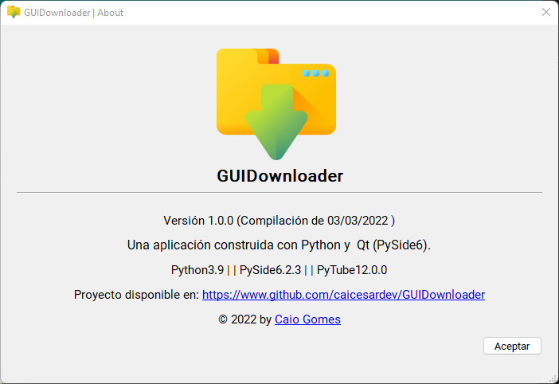
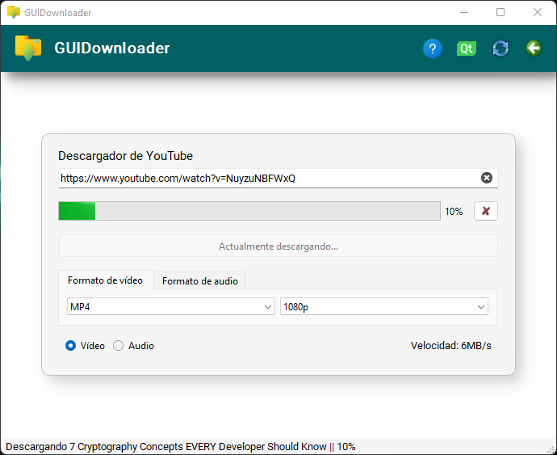
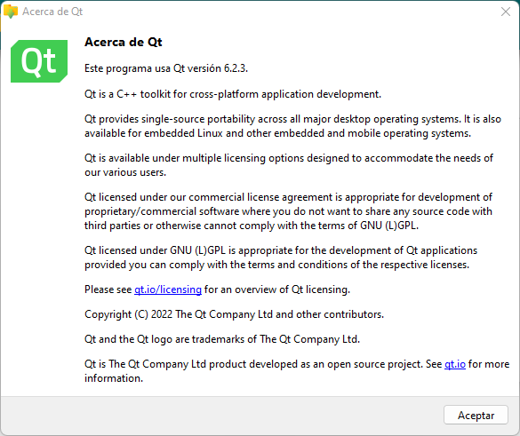

# GUIDownloader

A simple YouTube downloader with a desktop GUI built with Python, PySide6 and [yt-dlp](https://github.com/yt-dlp/yt-dlp).
Educational project released under the MIT license.

## Features

- Lists every format YouTube offers for a video:
  - **Video**: resolution, frame rate, HDR, container, codec (H.264, VP9, AV1) and size.
  - **Audio**: bitrate, container, codec (AAC, Opus), size and language when there are several tracks.
- Downloads video in MP4, WEBM or MKV (only containers compatible with the selected codec are offered), merging the best matching audio track.
- Downloads audio as MP3, M4A, Opus, FLAC, WAV or the original stream without conversion.
- Progress bar, speed and remaining time, and cancellation (partial files are cleaned up).
- Playlist parameters in the URL are ignored: only the selected video is downloaded.
- FFmpeg is bundled through `imageio-ffmpeg`; a custom FFmpeg folder can be set in *Archivo > Configuración*.

## Requirements

- Python 3.10 or newer.
- Dependencies in `requirements.txt` (`yt-dlp` includes `deno`, which YouTube requires to unlock every format).

## Getting started

```bash
python -m venv env
env\Scripts\activate
pip install -r requirements.txt
cd app
python main.py
```

## Tests

```bash
cd app
python -m unittest discover -s tests
```

## Building the Windows executable

Prebuilt binaries are attached to every [release](https://github.com/caicesardev/GUIDownloader/releases).
To build one yourself, from an activated virtual environment:

```bash
pip install -r requirements-dev.txt
powershell -ExecutionPolicy Bypass -File build.ps1
```

The script produces `dist/GUIDownloader/GUIDownloader.exe` (with FFmpeg and deno bundled) and a zip ready to publish.

## Regenerating the UI

After editing the `.ui` files with Qt Designer (`pyside6-designer`):

```bash
cd app
pyside6-uic ui/MainWindow.ui -o ui/MainWindow_ui.py
pyside6-uic ui/Settings.ui -o ui/Settings_ui.py
pyside6-uic ui/About.ui -o ui/About_ui.py
pyside6-rcc images.qrc -o images_rc.py
```

## Project structure

```
app/
├── main.py                 Entry point
├── constants.py
├── src/
│   ├── models/             Formats, metadata and download requests
│   ├── services/           yt-dlp options, format parsing, FFmpeg lookup, URL validation
│   ├── settings/           Persistent user preferences
│   ├── utils/              Size, duration and codec formatting
│   ├── windows/            Main, settings and about windows
│   └── workers/            Background threads for metadata and downloads
├── tests/
└── ui/                     Qt Designer files and generated code
```

---



---



---


